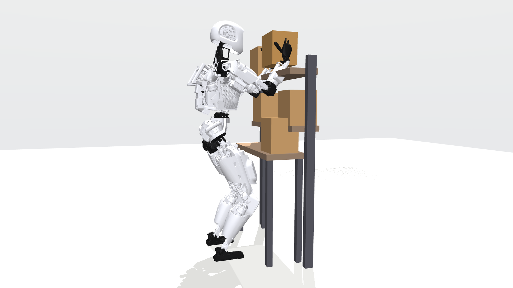

# Thermal-Aware Bimanual Humanoid Planner



**Status (Oct 2026): simulation study, results being written up.** A two-armed humanoid (Apptronik Apollo, 14 arm joints with datasheet-validated thermal models) loads boxes for 2-hour shifts. Main findings so far (20 runs per scenario):

- **Limb allocation is the thermal lever.** Switching between parallel single-arm lifts and two-arm lifts based on motor temperature raises throughput 16–25% over always lifting with both arms.
- **Arm posture barely matters:** the best posture saves at most 5% of heat in the most-loaded joint.
- **Forecasting doesn't beat a tuned reactive rule.** A forecast-based thermal planner matched, but did not beat, a simple temperature-triggered switch, and was less robust to ±30% motor-parameter error (2–5 vs 0–1 protective stops in 20 runs).

An earlier version of this README reported the planner beating reactive derating by 41%. That comparison lacked a two-arm baseline; with it, the claim does not hold.

A planner that forecasts each joint's winding temperature over a long repetitive bimanual task, plus reactive and fixed-rule baselines, all in one reproducible pipeline. Simulation only: Apptronik Apollo (MuJoCo Menagerie), upper body on a fixed base. All Python, runs on a laptop CPU.

## Quick start
```bash
pip install -r requirements.txt
git clone https://github.com/google-deepmind/mujoco_menagerie ~/mujoco_menagerie   # or set MENAGERIE_PATH
python scripts/rated_point_check.py          # thermal model vs datasheet (3 motors)
pytest -q                                    # unit tests
python experiments/run_sweep.py main         # 6 scenarios x 20 seeds x 6 controllers
python experiments/run_sweep.py paramerr     # thermal parameters off by up to ±30%
python experiments/run_sweep.py ablation     # one lever at a time
python experiments/make_figures.py           # figures/ and results/table_*.md
python experiments/make_video.py             # side-by-side replay video
python experiments/make_hero.py              # 1920x1080 portfolio render
python experiments/forward_check.py          # inverse dynamics vs forward simulation
python experiments/run_sweep.py sensitivity  # provisional thermal parameters varied
```
The first run builds the IK posture library and cycle-torque cache (~1 min), stored in `.cache/`.

**Results:** `results/` (v2, current) and `results/v1/` (superseded first version). Notes: [docs/HANDOFF.md](docs/HANDOFF.md).

## Pipeline
```
box stream ─► controller ─► (arm, posture, pace, pause)
                 ▲                     │
     joint temps │                     ▼
          thermal model ◄── joint torques: MuJoCo inverse dynamics along min-jerk
          (14 joints)       trajectories, with the held box as a payload
```

## Layout
| Path | What |
|---|---|
| `thermal/joint_model.py` | Two-node winding/housing model, R(T) and Kt(T), batch time-to-limit forecast with an exact steady-state shortcut |
| `params/actuators.yaml` | Every parameter with its source: Kollmorgen TBM(S) datasheet values, assumptions, provisional values |
| `sim/robot.py` | Apollo on a fixed base, work cell, payload bodies, inverse dynamics |
| `sim/ik.py` | Damped least-squares IK; null space toward a nominal posture or weighted copper loss |
| `sim/cycles.py` | Slot grid, 9-posture library per target, cached cycle torques (exact for any box mass) |
| `sim/shift.py` | Scenarios, box streams, shift runner, protective stop |
| `sim/controllers.py` | B1–B4 baselines and the proposed thermal-budget controller (with ablation switches) |
| `experiments/` | Sweeps and figure generation |
| `docs/` | Running notes and decisions |

## Model
```
C_w dT_w/dt = I² R(T_w) − (T_w − T_h)/R_wh
C_h dT_h/dt = (T_w − T_h)/R_wh − (T_h − T_amb)/R_ha
I = |τ_joint| / (N η Kt(T_w)),   R(T) = R_25 [1 + 0.00393 (T − 25)]
```
Kt falls linearly from its 25 °C to its 155 °C datasheet value, so a hot joint draws more current *and* has higher resistance at the same torque.

**Actuator sizing rule:** every arm joint uses a Kollmorgen TBM(S)-6013-A with gear ratio N chosen so that motor peak torque × N × η matches Apollo's published joint torque limit. Larger motors from the same datasheet (6025-A, 6051-A) form the motor-size design study.

**Validation:** at the datasheet's continuous current, steady winding temperature is within +1.1% / +1.2% / +4.9% of the rated 155 °C rise for the three motors.

## License
MIT. Robot model: Apptronik Apollo from [MuJoCo Menagerie](https://github.com/google-deepmind/mujoco_menagerie) (see its license; not redistributed here). Motor data: Kollmorgen TBM frameless motor selection guide.
