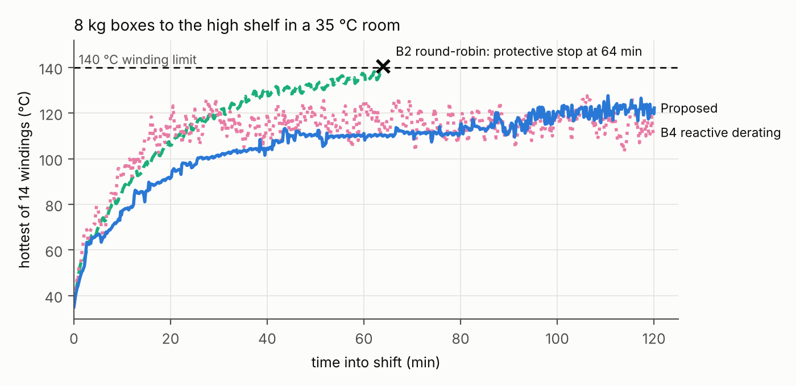
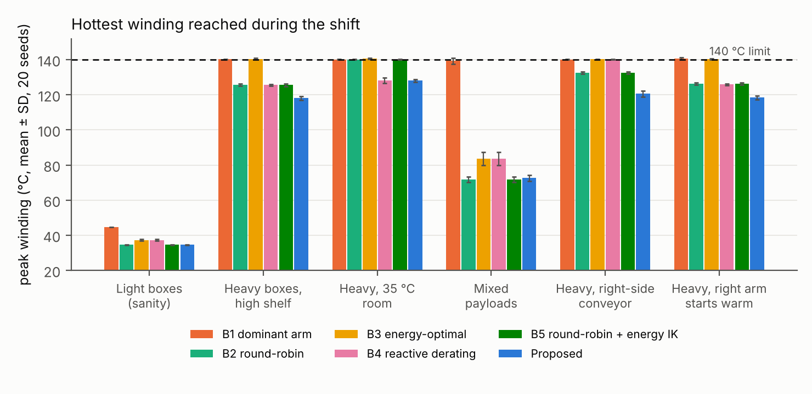

# Abstract

In long, repetitive manipulation shifts, a humanoid's throughput is limited less by its peak torque than by how long its joint windings stay below their temperature limit. We present a planner that forecasts every winding's temperature over the remaining shift and allocates a repetitive bimanual pick-and-place task accordingly. For each box it chooses between single-arm and two-arm grasps, which arm works, the arm posture, and the pace, so that no winding reaches its limit before the shift ends. Each joint uses a two-node winding/housing model with temperature-dependent resistance and torque constant, validated against a commercial frameless-motor datasheet to within 1.1–4.9% of the rated temperature rise. A per-joint loss gain, fitted online from measured winding temperature, corrects the model as the shift runs.

In simulation on the Apptronik Apollo humanoid (14 arm joints, 2-hour shifts, 6 scenarios, 20 runs each), the planner is the only controller that sustains full throughput in a 35 °C room: 1,334 boxes against 946 for reactive thermal derating (+41%) and 784 for alternating arms (+70%). With every thermal parameter of the plant perturbed by up to ±30%, it hits a protective stop in 1 of 20 runs per scenario, against 4–9 for every baseline, and completes 25–37% more boxes than the best baseline. Without online correction the same planner stops in 7–8 of 20 runs. An ablation shows that load allocation across limbs, not kinematic redundancy, carries the thermal benefit: the best feasible posture cuts heat in the most-loaded joint by at most 5%.

# I. Introduction

Humanoids are being deployed for warehouse and logistics work: moving totes, loading shelves, feeding conveyors for hours at a time. In that work the binding limit is often thermal, not kinematic. A joint motor can deliver its peak torque for seconds, but its continuous rating, set by how fast heat leaves the winding, is typically three to four times lower. A repetitive task whose RMS torque on one joint exceeds that rating will trip the joint's protective stop partway through the shift, however comfortably each individual lift sits inside the torque limit.

Commercial practice handles this reactively: when a winding crosses a threshold, the robot slows down or pauses until it cools. That protects the hardware but gives up throughput exactly when the robot is most loaded, and it cannot exploit the structure a bimanual robot offers. A humanoid has two arms, can lift with either or both, and can choose among postures and paces. Which of these levers to pull, and when, depends on how hot every joint will be at the end of the shift, not only on how hot it is now.

This paper treats the thermal limit as a budget to be planned over the whole shift. For each box, the planner forecasts every winding's temperature to the end of the shift under each candidate policy: single-arm or two-arm grasp, pace, and pauses. It picks the fastest policy that keeps every winding below its limit, then chooses the arm and a thermally weighted posture. The forecast uses a two-node winding/housing model per joint, and a per-joint loss gain fitted online from measured winding temperature keeps the forecast honest when the real motors differ from their datasheet.

The contributions are:

1. **Shift-horizon thermal budgeting for bimanual manipulation.** A planner that allocates a repetitive task across two arms, both arms together, and time, using a forecast to the end of the shift rather than a reaction to the current temperature. In a 35 °C environment it sustains full throughput where reactive derating loses 29% of throughput and alternating arms trips a protective stop in every run.
2. **Evidence that shift-length thermal plans are unsafe under datasheet error unless the model is corrected online.** With plant parameters perturbed by up to ±30%, the uncorrected planner stops in 7–8 of 20 runs; with a per-joint loss-gain correction, a simplified form of the online learning in [7], it stops in 1 of 20, against 4–9 for every baseline.
3. **An ablation showing that limb allocation, not kinematic redundancy, carries the benefit in manipulation.** Allocation alone recovers the full result; posture optimization alone fails in every run, because the payload's weight and reach, not the arm configuration, set the torque on the most-loaded joint.

All results are in simulation, on the Apptronik Apollo model, with motor parameters from a public datasheet. Section VII lists the limitations that follow from this.

# II. Related Work

**Thermal control of humanoid joints.** Urata et al. [1] introduced the two-resistor thermal model used here, with core (winding) and housing nodes. They estimate motor core temperature from housing temperature and current, and compute the maximum current a motor can carry over an extremely short interval, which suits bursts such as a jump but not ordinary motion [7]. Kumagai et al. [3] limit joint torque dynamically, adapting the maximum torque from the thermal model's temperature predictions; as summarized by Kawaharazuka et al. [7], each cap is the largest constant torque the joint can sustain for 120 s. Noda et al. [2], as summarized in [7], estimate housing temperature and, while a high-load posture is maintained, shift the center of gravity so that load moves away from hot joints, with predicted temperature in the optimization cost rather than as a hard limit. All three forecast temperature, but over a burst, a 120 s window or a held posture, and they act through a current or torque cap or a shift of the center of gravity. Our planner forecasts to the end of a 2-hour shift and decides which arm, or both, carries each load and at what pace.

**Thermal recovery and thermal inverse kinematics.** Jorgensen et al. [4] fit a first-order, effort-based thermal model on NASA's Valkyrie and use it in a receding-horizon controller (about 20 s) that seeks contact-constrained configurations to recover actuators from unsafe temperatures. They switch between contact modes so that one leg cools while the other bears load. Our work differs in purpose and horizon: we plan forward over the whole shift to avoid unsafe states rather than recover from them, and we find that in manipulation, configuration changes are a weak lever compared with allocating work between arms (Section VI-C).

**Thermally aware learned controllers.** Qian et al. [5] feed motor temperatures to a reinforcement-learning locomotion policy for a quadruped, with a barrier-function reward that discourages approaching the limit. The policy learns posture adaptations that reduce torque. Our planner is model-based and needs no training, and its forecast exposes the remaining thermal budget explicitly.

**Online thermal model learning.** Kawaharazuka et al. [7] update the five parameters of a two-resistor core/housing/ambient model online from a housing sensor, motivated by parameter and ambient drift in real use (an old and a new motor differed by about 15 °C in housing temperature over 90 s), and optimize each motor's output limit over a 30 s horizon on a musculoskeletal humanoid. Online model correction is therefore not our contribution, and our per-joint loss gain is a simpler variant of it. What we add is its role over a shift: a fixed datasheet error that matters little over 30 s compounds over two hours, and we measure how often a shift-length allocation plan fails with and without correction. Sevinchan et al. [6] review thermal management for robots more broadly, including hardware cooling, which is complementary to the planning considered here.

**Reactive derating.** Industrial servo drives and robot controllers commonly fold back current or speed as winding temperature rises. Baseline B4 models this practice.

# III. Joint Thermal Model

Each joint $j$ is a frameless BLDC motor driving a strain-wave gear of ratio $N$ and efficiency $\eta$. Its thermal state is two lumped temperatures, following the two-resistor model of Urata et al. [1]: the core (winding) $T_w$, which carries the copper loss, and the housing $T_h$, which includes the stator iron, aluminum housing and gear.

$$C_w \frac{dT_w}{dt} = P_{cu} - \frac{T_w - T_h}{R_{wh}}, \qquad C_h \frac{dT_h}{dt} = \frac{T_w - T_h}{R_{wh}} - \frac{T_h - T_{amb}}{R_{ha}}$$

Copper loss follows from joint torque $\tau$ through the gear and the motor's temperature-dependent constants:

$$P_{cu} = g_j \, \frac{\tau^2}{(N \eta K_t(T_w))^2} \, R(T_w), \qquad R(T) = R_{25}\,[1 + \alpha_{cu}(T - 25)]$$

The torque constant $K_t$ falls linearly from its 25 °C to its 155 °C datasheet value as the magnets weaken, taking magnet temperature equal to winding temperature (conservative). A hot joint therefore draws more current *and* has a higher resistance at the same torque, so losses grow faster than linearly with temperature. The gear loss is charged in both directions of power flow, also conservative. The gain $g_j$ equals 1 in the nominal model and is the quantity corrected online (Section IV-D).

**Parameters.** Motor constants come from one public datasheet, the Kollmorgen TBM(S) frameless series [10]: $R_{25}$, $K_t$ at 25 °C and 155 °C, and the total winding-to-ambient thermal resistance $TPR = R_{wh} + R_{ha}$. The datasheet gives only the total, so we split it 35/65 between the two resistances and set $C_w$ from 60% of the motor mass (copper and stator iron) and $C_h$ from the housing and gear masses. These split values are provisional; Section VI-D tests the planner's sensitivity to them. The resulting time constants are 74 s (winding) and 10.8 min (housing) for the TBM(S)-6013-A used in the experiments.

**Validation against the datasheet.** At the datasheet's continuous current $I_c$ and 25 °C ambient, the winding should settle at the rated 155 °C, a 130 °C rise. Solving the model's steady state for three motor sizes reproduces that rise to within 5%:

| Motor | $I_c$ (A) | Model steady winding (°C) | Error in rise |
| --- | --- | --- | --- |
| TBM(S)-6013-A | 5.51 | 156.4 | +1.1% |
| TBM(S)-6025-A | 5.58 | 156.6 | +1.2% |
| TBM(S)-6051-A | 6.54 | 161.3 | +4.9% |

Run the same check at the datasheet's continuous *torque* $T_c$ and the model settles 12–17% low. The datasheet is internally inconsistent here: $I_c \times K_{t,hot}$ exceeds $T_c$ by 3.6–6.6%, which is 7–14% in copper loss, and lies within the ±10% tolerance the datasheet quotes on $K_t$. We validate on current, because current, not torque, is what the model's loss term consumes, and we do not tune parameters to close the torque gap.

# IV. Thermal Budget Planner

The planner makes one decision per box, in four steps, each using the joint model of Section III with the measured winding and housing temperatures as its initial state.

## A. Shift-horizon policy selection

A policy is a grasp mode (alternate single arms, or a two-arm grasp), a pace multiplier $p \in \{1.0, 1.25, 1.5\}$ that stretches the cycle duration, and a pause $d \in \{0, 1, 2, 4, 8, 15\}$ s added after each cycle: 36 candidates. For each candidate the planner computes the cycle-averaged squared torque on all 14 joints, using the measured torque profile of the current pick-and-place cycle and a box mass forecast from an exponential moving average of recent boxes (weight 0.1 on the newest). Under alternation, both arms' cycles are averaged together; the idle arm holds its rest posture.

Each candidate's load is held constant and the model is integrated forward from the current state to the end of the shift plus a 60 s margin. The planner chooses the candidate with the highest throughput (boxes per second) whose forecast keeps every winding below $T_{lim} = 140$ °C over that horizon. If none qualifies, it chooses the candidate that delays the first limit crossing longest. Policy selection runs every five boxes.

Most forecasts end early. The two-node network is a cooperative system: if a joint starts at or below its steady state for a load, it stays below it. So a joint whose steady winding temperature is below $T_{lim}$, and which starts below its steady state on both nodes, can never reach the limit, and needs no integration. The remaining candidates are integrated with second-order Runge–Kutta at a 10 s step. This shortcut matches brute-force integration exactly in unit tests, and a whole 2-hour shift (1,334 decisions) plans in 15–30 s on one laptop CPU core.

## B. Arm choice

Under alternation, each box goes to the arm whose most-loaded joint has the larger forecast time to limit, if that arm took this pick repeatedly. When both arms are safe to the end of the shift, the box goes to the arm whose hottest winding is furthest from $T_{lim}$, which keeps the two arms' temperatures close.

## C. Thermally weighted posture

For every pick, place and approach point, and for left, right and two-arm grasps, an offline library holds nine postures that reach the same grasp point: a minimum-norm IK solution and eight optimized ones. The optimized postures minimize weighted static copper loss $\sum_j w_j c_j \tau_j^2$, where $c_j = R_{25} / (N \eta K_t)^2$ is the joint's loss coefficient, with either uniform weights (energy-optimal) or one joint's weight raised tenfold (relieve that joint). They are solved with SLSQP [11] under the grasp-point equality, joint limits, static torque at most 85% of each joint's limit, and a trust region of ±0.6 rad (shoulder and elbow) and ±0.3 rad (wrist) around the minimum-norm solution. Without the trust region the optimizer twists the wrist roll by over a radian, which is cheap statically but needs about three times the wrist's torque limit to move through in one second.

Online, the planner discards any posture whose cycle would exceed a joint's torque limit for the actual box, then picks the one minimizing $\sum_j w_j c_j \bar{\tau}_j^2$ over the cycle, with thermal weights

$$w_j = \left(\frac{T_{lim} - T_{amb}}{T_{lim} - T_{w,j}}\right)^2$$

A cold robot therefore chooses the energy-optimal posture; as a joint approaches its limit, load moves off it.

## D. Online model correction

The real motors will not match the datasheet. After each box, the planner re-predicts the winding temperatures it just measured, starting from the previous measured state and applying the loads it actually commanded, once with the current gains $g$ and once with $g(1 + 0.05)$. The difference gives each joint's sensitivity $s_j$ of the prediction to its gain, and the error $e_j$ between measurement and prediction sets a damped Newton step:

$$g_j \leftarrow \operatorname{clip}\left(g_j + 0.3\, \frac{e_j}{s_j},\ 0.5,\ 2.5\right) \quad \text{for } |s_j| > 0.02\ ^\circ\mathrm{C}$$

Joints with too little load to be informative keep their gain. The gain absorbs errors in $R$, $K_t$ and thermal resistance, which all scale the winding's temperature rise. With an exact model the gain stays at 1.000, so correction changes nothing when nothing is wrong.

# V. Experimental Setup

{width=95%}

**Robot and dynamics.** We use the Apptronik Apollo humanoid from MuJoCo Menagerie [9] in MuJoCo [8], with its floating base removed and its pelvis, legs, torso and neck held at the standing pose. The 14 arm joints (7 per arm) are the only moving degrees of freedom. Joint torques come from MuJoCo inverse dynamics along minimum-jerk joint trajectories between IK waypoints, with the held box modeled as a 0.24 m uniform cube attached at the grasp point. Torques are sampled at 8 Gauss–Legendre nodes per trajectory segment. Payload torque is linear in box mass, so each cycle stores a no-load and a per-kilogram component, and the mean squared torque for any box mass is exact without re-simulating. A forward-simulation check (1 kHz, PID tracking at Apollo's position gains with inverse-dynamics feedforward that includes the box, torques clipped to Apollo's limits) reproduces these torques: across four representative cycles, copper loss agrees within 0.1%, tracking error stays below 0.15°, and the time for the hottest winding to reach 140 °C is unchanged. Dense 1 kHz inverse dynamics and the 8-node quadrature agree to within 0.001 Nm RMS.

**Actuators.** Every arm joint uses a TBM(S)-6013-A motor [10] with gear efficiency 0.80. Each joint's gear ratio is chosen so that the motor's peak torque times $N\eta$ matches Apollo's published joint torque limit, which gives a peak-to-continuous ratio of about 3.3, typical of humanoid joint actuators:

| Joint | Gear ratio | Peak torque (Nm) | Apollo limit (Nm) | Continuous at 25 °C (Nm) |
| --- | --- | --- | --- | --- |
| Shoulder abduction | 70 | 77.8 | 78 | 23.6 |
| Shoulder rotation | 60 | 66.7 | 67 | 20.2 |
| Shoulder flexion | 100 | 111 | 114 | 33.7 |
| Elbow flexion | 100 | 111 | 114 | 33.7 |
| Wrist roll | 10 | 11.1 | 10.6 | 3.4 |
| Wrist yaw, pitch | 30 | 33.4 | 34.2 | 10.1 |

**Task.** Boxes arrive at one of five slots on a 0.85 m table and go to one of six slots on a standard (1.04 m) or high (1.42 m) shelf; Apollo's shoulders are at 1.37 m. Each cycle runs home, approach, grasp (0.3 s), lift, transfer, place, release (0.3 s), retreat and home, in 5.4 s at full pace, so a 2-hour shift holds at most 1,334 boxes. Any winding reaching 140 °C triggers a protective stop, which ends the shift.

**Scenarios.** Box mass, destination and conditions are drawn per run from these sets; 20 runs (seeds) per cell. At 8 kg a single-arm lift reaches 93% of Apollo's torque limit, so every grasp mode is feasible but heavily loaded.

| Scenario | Box mass (kg) | Shelf | Other condition |
| --- | --- | --- | --- |
| Light | 2 | Standard | Sanity check |
| Heavy | 8 | High | |
| Warm room | 8 | High | 35 °C ambient |
| Mixed | 2, 4, 6, 8 | Both | |
| Right-side conveyor | 8 | High | Boxes arrive only on the robot's right |
| Warm start | 8 | High | Right arm starts at 110 °C winding, 90 °C housing |

**Baselines.** B1 uses the right arm only. B2 alternates arms (round-robin). B3 uses the nearer arm with the copper-loss-optimal posture. B4 is reactive derating: the nearer arm at full pace until any winding reaches 120 °C, then the slowest pace with a 4 s pause per box until it falls below 110 °C. B5 alternates arms and uses the copper-loss-optimal posture, the strongest controller that ignores temperature. All baselines use the same posture library and the same torque-feasibility filter as the planner.

**Model error.** For the robustness study, each thermal parameter of the plant ($R_{wh}$, $R_{ha}$, $C_w$, $C_h$, $R_{25}$, $K_t$) is scaled by an independent factor drawn uniformly from [0.7, 1.3] per run and shared by all joints, a systematic mismatch such as a different housing or a different winding batch. The planner keeps the datasheet values and reads the plant's true temperatures.

**Metrics.** Boxes completed in the shift, whether and when a protective stop occurred, and the peak winding temperature reached.

# VI. Results

## A. Exact thermal model

The planner completes all 1,334 boxes in every run of every scenario, and it is the only controller that does so in the warm room (Table I).

*Table I. Boxes completed per 2-hour shift, mean of 20 runs (maximum 1,334). ✕ = protective stop in all 20 runs.*

| Scenario | B1 dominant | B2 round-robin | B3 energy-opt. | B4 reactive | B5 RR + energy | **Proposed** |
| --- | --- | --- | --- | --- | --- | --- |
| Light | 1334 | 1334 | 1334 | 1334 | 1334 | **1334** |
| Heavy | 103 ✕ | 1334 | 414 ✕ | 1082 | 1334 | **1334** |
| Warm room | 81 ✕ | 784 ✕ | 278 ✕ | 946 | 792 ✕ | **1334** |
| Mixed | 1051 (14 stops) | 1334 | 1334 | 1334 | 1334 | **1334** |
| Right-side conveyor | 113 ✕ | 1334 | 113 ✕ | 308 ✕ | 1334 | **1334** |
| Warm start | 12 ✕ | 1334 | 126 ✕ | 1009 | 1334 | **1334** |

In the warm room the planner moves 41% more boxes than reactive derating and 70% more than round-robin, which trips its stop at a median 71 min. Fig. 2 shows why. Round-robin heats the right shoulder flexion steadily to the limit. Reactive derating oscillates around its 120 °C threshold; its mean cycle of 7.6 s implies about a third of its boxes ran at the derated pace. The planner moves most boxes with a two-arm grasp (830–940 of 1,334 across runs), which halves each shoulder's share of the payload. Its hottest winding reaches 109 °C at 40 min and climbs to 125 °C only in the last minutes, as the planner spends the budget it no longer needs to save.

{width=95%}

The nearest-arm controllers (B1, B3, B4) collapse whenever boxes arrive on one side, because they load one arm. Plain alternation (B2, B5) is a strong baseline: it also finishes the heavy, conveyor and warm-start scenarios. There the planner's advantage is thermal margin rather than throughput: its hottest winding peaks 8–12 °C lower (Fig. 3). Section VI-B shows that this margin is what keeps it running when the model is wrong.

{width=95%}

## B. Robustness to model error

With every thermal parameter of the plant off by up to ±30%, the planner stops in 1 of 20 runs per scenario, against 4–9 for every baseline, and completes 25–37% more boxes than the best baseline in each scenario (Fig. 4).

![Boxes per shift, mean of 20 runs, with every plant thermal parameter scaled by a factor in [0.7, 1.3]. Labels: runs that hit a protective stop.](../figures/fig3_param_error.png){width=95%}

Online correction is what makes the forecast safe. Without it, the same planner stops in 7–8 of 20 runs per scenario and averages 994–1,034 boxes, barely better than the baselines. Every one of those stops occurred in a run whose plant loss coefficient $R/K_t^2$ was at least 15% above datasheet: the forecast reported a safe policy, so the planner never slowed down. With correction, three such plants (loss coefficients 1.18×, 1.24× and 1.49×) finish the heavy scenario with 1,184, 1,149 and 999 boxes, by slowing the cycle to 6.1–7.2 s.

One plant draw still fails in all four scenarios: copper loss 1.40× and housing-to-ambient resistance 1.13× the model's. Our hypothesis, not yet tested: the single gain fits the winding's fast response within a few boxes, but the housing's slower excess rise reaches the winding only over tens of minutes, after the gain has settled too low. A second adapted parameter for the housing node would address this.

## C. Which lever matters

Load allocation across limbs accounts for the whole benefit (Table II). With only the grasp-mode and arm choices enabled, the planner still finishes every box in every scenario. Pacing alone survives at about half throughput. Posture alone fails in every run.

*Table II. Boxes per shift with one lever enabled, mean of 10 runs (full planner: 20 runs). ✕ = stop in all runs.*

| Scenario | Full planner | Arm and grasp mode only | Pacing only | Posture only |
| --- | --- | --- | --- | --- |
| Warm room | 1334 | 1334 | 633 | 301 ✕ |
| Right-side conveyor | 1334 | 1334 | 681 (2 stops) | 122 ✕ |
| Warm start | 1334 | 1334 | 723 | 155 ✕ |

Posture is weak for a physical reason. The torque on shoulder flexion, the most-loaded joint, is roughly the box's weight times its horizontal distance from the shoulder axis, and the grasp target fixes that distance. The arm's redundant degrees of freedom can move only the arm's own mass. Across all 90 pick-place-grasp combinations at 8 kg, the best feasible posture cuts total cycle copper loss by 3% on average (17% at most) and heat in the right shoulder flexion by at most 5%. The two pacing-only stops in the conveyor scenario occurred in the final 30 s of the shift: the planner spends its budget up to the end, and its 10 s forecast step is slightly coarse at the boundary. The size of the safety margin (0 s, 60 s or 10 min) changed no outcome.

## D. Sensitivity to the provisional thermal parameters

The planner's result does not depend on the estimated node split or heat capacities (Table III). We varied the winding share of the datasheet's total thermal resistance from 35% to 20% and 50%, and halved and doubled each node's heat capacity, applying each variant to plant and planner alike. This spans winding time constants of 37–148 s and housing time constants of 5.4–21.5 min. In every variant and every run, the planner completed all 1,334 boxes without a stop, in both the warm-room and conveyor scenarios, with peak winding temperatures of 117–132 °C.

*Table III. Warm room: boxes per shift, mean of 10 runs, with the provisional thermal parameters varied. In parentheses: runs with a protective stop.*

| Variant | Winding $\tau$ | Housing $\tau$ | B2 round-robin | B4 reactive | **Proposed** |
| --- | --- | --- | --- | --- | --- |
| Nominal (35/65 split) | 74 s | 10.8 min | 765 (10) | 949 (0) | **1334 (0)** |
| Split 20/80 | 42 s | 13.3 min | 1016 (10) | 972 (0) | **1334 (0)** |
| Split 50/50 | 106 s | 8.3 min | 587 (10) | 929 (0) | **1334 (0)** |
| Winding capacity ×0.5 | 37 s | 10.8 min | 574 (10) | 934 (0) | **1334 (0)** |
| Winding capacity ×2 | 148 s | 10.8 min | 1195 (7) | 972 (0) | **1334 (0)** |
| Housing capacity ×0.5 | 74 s | 5.4 min | 498 (10) | 920 (0) | **1334 (0)** |
| Housing capacity ×2 | 74 s | 21.5 min | 1296 (6) | 1005 (0) | **1334 (0)** |

The baselines' absolute numbers do move with these estimates: round-robin completes between 498 and 1,296 boxes depending on the variant, because a faster-heating joint reaches the limit sooner. The quantitative gaps reported in Section VI-A should therefore be read as specific to the nominal parameters, while the ordering and the planner's zero-stop result hold across the range. B5 tracked B2 within 5 boxes in every variant. In the conveyor scenario, reactive derating stopped in every run of every variant (188–533 boxes), while round-robin and the planner finished all of them.

# VII. Discussion and Limitations

**What transfers.** The planner's main lever, deciding which limb or limbs carry each load given a forecast of the whole shift, needs only joint torques and winding temperatures, both of which humanoid joint drives typically measure or estimate already. The online correction needs no extra sensors. The posture result is a negative one: for repetitive lifting, effort spent on thermally optimal IK buys little, because the payload, not the configuration, sets the dominant torque.

**When the planner does not help.** With light payloads, every controller finishes. Under plain alternation of heavy boxes in a 25 °C room, the planner gains margin but no throughput. Its value grows with how close the task runs to the thermal limit and how uncertain the model is.

**Limitations.**

- **Dynamics.** Torques come from inverse dynamics on scripted minimum-jerk trajectories. Forward simulation confirms them when the controller's feedforward includes the box (Section V), so the results assume the payload mass is known after the grasp, for example from a wrist force sensor or joint torques. Without it, feedback alone must carry the payload: copper loss rises 6–24% in the two-arm and light cases, and a one-arm 8 kg lift saturates the wrist roll and loses tracking. Contact and impact loads are absent.
- **Fixed base.** The legs, balance and the torso's own loading are not modeled; a standing humanoid would add thermal load in the hips and knees that depends on the arm posture.
- **Grasping.** The box is a rigid payload attached at the grasp point; there is no friction, slip or regrasp, and the two-arm grasp splits the payload equally.
- **Thermal model.** The split of the datasheet's total thermal resistance between winding and housing, and both heat capacities, are estimated from masses rather than measured; Section VI-D shows the planner's result holds across a wide range of them, but the baselines' absolute numbers do not. Joints are thermally independent, with no conduction between neighbouring actuators.
- **Sensing.** The planner reads both node temperatures. Hardware usually measures the winding (or a sensor near it) and would have to estimate the housing node.
- **Scope.** One robot, one motor family and one task. The remaining model-error failure (Section VI-B) is unresolved.

The immediate next steps are a finite-element thermal model of the joint housing to replace the provisional node split, and a second adapted parameter for the housing node.

# VIII. Conclusion

Planning a humanoid's thermal budget over the whole shift, rather than reacting to the current temperature, lets it sustain full throughput where reactive derating loses 29% and simple alternation trips a protective stop. The benefit comes from allocating work across arms and grasp modes; posture optimization contributes little in manipulation. An open-loop forecast is not safe under realistic parameter error, but a per-joint loss gain fitted online from measured winding temperature restores safety at no sensing cost: 1 stop in 20 runs, against 4–9 for every baseline. The code, parameters and all experiment scripts are available at <https://github.com/sharanankathi/thermal-aware-humanoid-planner>.

# References

1. J. Urata, T. Hirose, Y. Namiki, Y. Nakanishi, I. Mizuuchi, and M. Inaba, "Thermal control of electrical motors for high-power humanoid robots," in *Proc. IEEE/RSJ Int. Conf. Intelligent Robots and Systems (IROS)*, 2008, pp. 2047–2052, doi:10.1109/IROS.2008.4651110.
2. S. Noda, M. Murooka, S. Nozawa, Y. Kakiuchi, K. Okada, and M. Inaba, "Online maintaining behavior of high-load and unstable postures based on whole-body load balancing strategy with thermal prediction," in *Proc. IEEE Int. Conf. Automation Science and Engineering (CASE)*, 2014, pp. 1166–1171.
3. I. Kumagai, S. Noda, S. Nozawa, Y. Kakiuchi, K. Okada, and M. Inaba, "Whole body joint load reduction control for high-load tasks of humanoid robot through adapting joint torque limitation based on online joint temperature estimation," in *Proc. IEEE-RAS Int. Conf. Humanoid Robots*, 2014, pp. 463–468, doi:10.1109/HUMANOIDS.2014.7041402.
4. S. J. Jorgensen, J. Holley, F. Mathis, J. S. Mehling, and L. Sentis, "Thermal recovery of multi-limbed robots with electric actuators," *IEEE Robotics and Automation Letters*, 2019, doi:10.1109/LRA.2019.2894068.
5. L. Qian, Y. Wan, S. Wang, and X. Luo, "Learning thermal-aware locomotion policies for an electrically-actuated quadruped robot," arXiv:2603.01631, 2026.
6. E. Sevinchan, I. Dincer, and H. Lang, "A review on thermal management methods for robots," *Applied Thermal Engineering*, vol. 140, pp. 799–813, 2018.
7. K. Kawaharazuka, N. Hiraoka, K. Tsuzuki, M. Onitsuka, Y. Asano, K. Okada, K. Kawasaki, and M. Inaba, "Estimation and control of motor core temperature with online learning of thermal model parameters: application to musculoskeletal humanoids," arXiv:2407.08055, 2024.
8. E. Todorov, T. Erez, and Y. Tassa, "MuJoCo: A physics engine for model-based control," in *Proc. IEEE/RSJ Int. Conf. Intelligent Robots and Systems (IROS)*, 2012, pp. 5026–5033.
9. K. Zakka, Y. Tassa, and MuJoCo Menagerie Contributors, "MuJoCo Menagerie: A collection of high-quality simulation models for MuJoCo," 2022, <https://github.com/google-deepmind/mujoco_menagerie>.
10. Kollmorgen, "TBM frameless motor selection guide," KM_SG_00218_RevE_EN, 2017.
11. D. Kraft, "A software package for sequential quadratic programming," DFVLR-FB 88-28, German Aerospace Center (DLR), 1988.
