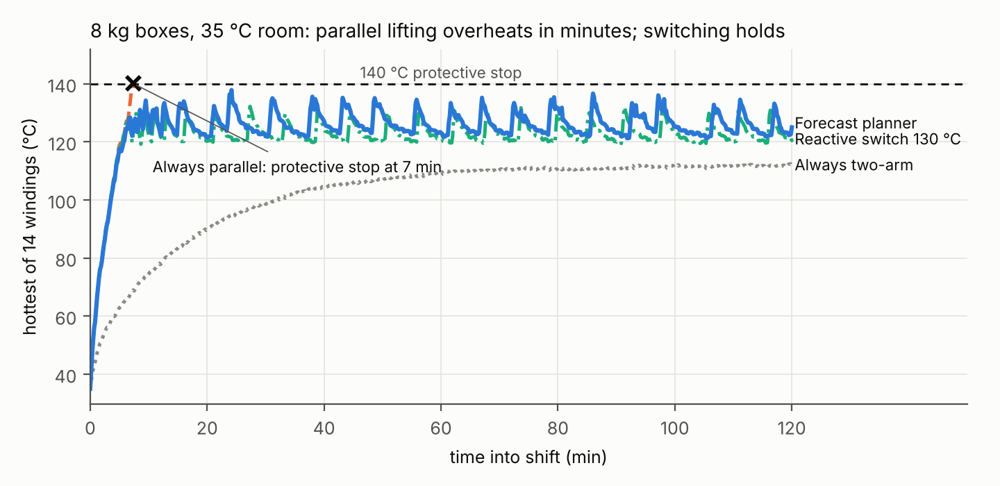
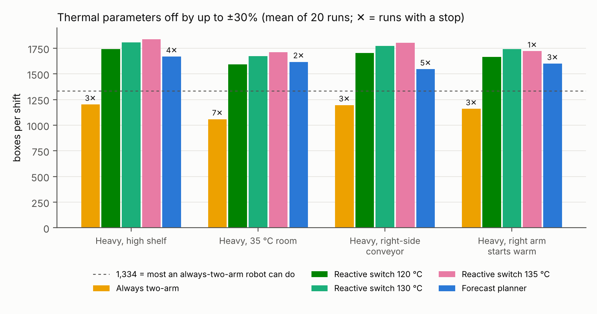

# Abstract

In long, repetitive lifting shifts, a humanoid's throughput is limited by how long its joint motors stay below their temperature limit, not by peak torque. We ask which strategy best manages that limit for a two-armed robot: choosing which limbs carry each load, choosing the arm posture, slowing down, or planning ahead with a temperature forecast. We model each of the 14 arm joints of the Apptronik Apollo humanoid with a two-node winding/housing thermal model whose rated temperature rise matches a commercial frameless-motor datasheet to within 1.1–4.9%, and simulate 2-hour box-loading shifts in which the robot can lift two boxes in parallel (one per arm) or one box with both arms. Across six scenarios and 20 runs each, three findings stand out. First, limb allocation is the lever: a reactive rule that lifts in parallel until a winding reaches 130–135 °C, then switches to two-arm lifts until it cools, completes 13–25% more boxes than always lifting with both arms, while always lifting in parallel trips a protective stop within 1–9 minutes. Second, posture optimization is nearly useless here: the best feasible posture cuts heat in the most-loaded joint by at most 5%. Third, a forecast-based planner that looks ahead to the end of the shift did not beat the reactive rule. It matched it with an exact model, and with every thermal parameter perturbed by up to ±30% it hit protective stops in 2–5 of 20 runs per scenario, while the reactive rules had 0–1. We conclude that for repetitive bimanual lifting, a simple temperature-triggered switch between parallel and two-arm lifting captures nearly all of the available thermal headroom, and that a threshold near 130 °C is robust to realistic model error. Code and data are open.

# I. Introduction

Humanoids are being deployed for warehouse and logistics work: moving totes, loading shelves, feeding conveyors for hours at a time. In that work the binding limit is often thermal. A joint motor can deliver its peak torque for seconds, but its continuous rating, set by how fast heat leaves the winding, is typically three to four times lower. A repetitive task whose RMS torque on one joint exceeds that rating trips the joint's protective stop partway through the shift, however comfortably each individual lift sits inside the torque limit.

A two-armed robot has several ways to manage this. It can choose which limbs carry each load: one box per arm in parallel (fast, but each arm carries a full box) or one box with both arms (slower, but each arm carries half). It can choose among redundant arm postures to shift torque away from a hot joint. It can slow down or pause. And it can decide when to do each of these reactively, from the current temperature, or predictively, from a forecast of every joint's temperature to the end of the shift.

This paper measures how much each of these strategies is worth. We set out to show that a forecast-based planner would beat reactive approaches. With weak baselines it appeared to: an earlier version of this study, which lacked a two-arm baseline, reported a 41% throughput gain over reactive slow-down. With the baselines a practitioner would actually deploy, that advantage disappears. We report the full comparison.

The contributions are:

1. **A controlled comparison of thermal-management strategies for a two-armed humanoid** in long repetitive lifting, using a datasheet-validated thermal model of all 14 arm joints, six scenarios, 20 runs per condition, and a ±30% model-error study.
2. **Evidence that limb allocation is the dominant lever.** Switching between parallel and two-arm lifting at a temperature threshold yields 13–25% more boxes than always lifting with both arms. Posture optimization yields at most 5% heat reduction in the most-loaded joint.
3. **A negative result for forecast-based thermal planning in this setting.** A two-stage lookahead planner with online model correction matched, but did not beat, a tuned reactive switch, and was less robust to model error. Reactive control on measured temperature is inherently robust to the parameter errors that a forecast depends on.

All results are in simulation, with motor parameters from a public datasheet. Section VII lists the limitations.

# II. Related Work

**Thermal control of humanoid joints.** Urata et al. [1] introduced the two-resistor thermal model used here, with core (winding) and housing nodes. They estimate motor core temperature from housing temperature and current, and compute the maximum current a motor can carry over an extremely short interval, suited to bursts such as a jump [7]. Kumagai et al. [3] limit joint torque dynamically from the thermal model's temperature predictions; as summarized by Kawaharazuka et al. [7], each cap is the largest constant torque sustainable for 120 s. Noda et al. [2], as summarized in [7], estimate housing temperature and shift the center of gravity while a high-load posture is maintained, with predicted temperature in the optimization cost. These works act within a single limb or posture over seconds to minutes; we compare strategies that allocate a repetitive task across two arms over a 2-hour shift.

**Thermal recovery and thermal inverse kinematics.** Jorgensen et al. [4] use a first-order thermal model on NASA's Valkyrie in a receding-horizon controller (about 20 s) that seeks contact-constrained configurations to recover actuators from unsafe temperatures, switching contact modes so that one leg cools while the other bears load. Their contact-mode switching is the locomotion analogue of the limb allocation we find dominant in manipulation; their configuration optimization is the analogue of the posture lever we find weak.

**Thermally aware learned controllers.** Qian et al. [5] feed motor temperatures to a reinforcement-learning locomotion policy for a quadruped with a barrier-function reward near the limit. Our planner is model-based; our results suggest that a learned policy in this setting would need to beat a simple reactive switch, not just a thermally blind baseline.

**Online thermal model learning.** Kawaharazuka et al. [7] update the parameters of a two-resistor model online and optimize each motor's output limit over a 30 s horizon on a musculoskeletal humanoid. Our forecast planner uses a simpler per-joint loss-gain correction. We find that correction is necessary for a shift-length forecast (without it, 8–9 of 20 runs stop under ±30% error) but not sufficient to beat reactive control.

**Reactive derating.** Industrial servo drives commonly fold back current or speed as winding temperature rises. Our reactive baselines model this, plus a reactive switch between lifting modes.

# III. Joint Thermal Model

Each joint is a frameless BLDC motor driving a strain-wave gear of ratio $N$ and efficiency $\eta$. Its thermal state is two lumped temperatures, following the two-resistor model of [1]: the core (winding) $T_w$, which carries the copper loss, and the housing $T_h$, which includes the stator iron, aluminum housing and gear.

$$C_w \frac{dT_w}{dt} = P_{cu} - \frac{T_w - T_h}{R_{wh}}, \qquad C_h \frac{dT_h}{dt} = \frac{T_w - T_h}{R_{wh}} - \frac{T_h - T_{amb}}{R_{ha}}$$

$$P_{cu} = g_j \, \frac{\tau^2}{(N \eta K_t(T_w))^2} \, R(T_w), \qquad R(T) = R_{25}\,[1 + \alpha_{cu}(T - 25)]$$

The torque constant $K_t$ falls linearly from its 25 °C to its 155 °C datasheet value as the magnets weaken, so a hot joint draws more current and has a higher resistance at the same torque. The gain $g_j$ is 1 in the nominal model and is corrected online by the forecast planner.

**Parameters.** Motor constants come from the Kollmorgen TBM(S) frameless series [10]. The datasheet gives only the total winding-to-ambient thermal resistance, which we split 35/65 between the two nodes; heat capacities come from component masses. These split values are provisional and are varied in Section VI-D. For the TBM(S)-6013-A used in all experiments, the time constants are 74 s (winding) and 10.8 min (housing).

**Validation.** At the datasheet's continuous current and 25 °C ambient, the model's steady winding temperature reproduces the rated 130 °C rise to within 5%:

| Motor | $I_c$ (A) | Model steady winding (°C) | Error in rise |
| --- | --- | --- | --- |
| TBM(S)-6013-A | 5.51 | 156.4 | +1.1% |
| TBM(S)-6025-A | 5.58 | 156.6 | +1.2% |
| TBM(S)-6051-A | 6.54 | 161.3 | +4.9% |

At the datasheet's continuous torque the model settles 12–17% low, because the datasheet's torque and current ratings disagree by 3.6–6.6% (within its ±10% $K_t$ tolerance). We validate on current, which is what the loss term consumes, and do not tune parameters to close the gap.

# IV. Strategies Compared

**Lifting modes.** A *single-arm* lift moves one box with one arm while the other rests. A *parallel* lift moves two boxes in one cycle, one per arm, doubling throughput; we assume the arms do not collide. A *two-arm* lift moves one box with both arms, halving each arm's share of the payload. A cycle takes 5.4 s at full pace, so a 2-hour shift holds at most 1,334 cycles: 2,668 boxes in parallel, 1,334 otherwise.

**Baselines.** B2 alternates single arms. B4 uses the nearer single arm and slows down (1.5× cycle time plus a 4 s pause) above 120 °C until below 110 °C, a common derating scheme. B6 always lifts with two arms. B7 always lifts in parallel. B8 is a reactive mode switch: parallel lifts until any winding reaches $T_{on}$, two-arm lifts until it falls below $T_{off}$, with an additional slow-down above a third threshold. We test B8 at 120/110 °C, 130/120 °C and 135/125 °C.

**Forecast planner.** Every five boxes, the planner evaluates candidate policies (lifting mode × pace ∈ {1.0, 1.25, 1.5} × pause ∈ {0–15 s}) by integrating the thermal model from the measured temperatures. It uses a two-stage lookahead: it holds the fastest action for the next ~27 s window, provided that from the predicted state some policy can finish the shift without any winding passing 135 °C (a 5 °C allowance below the 140 °C stop for within-cycle temperature ripple), and scores each action by total boxes over the remaining shift. Ties go to the cooler option. A per-joint loss gain, fitted after every box from the measured versus predicted winding rise, corrects the model online. A posture library of nine IK solutions per target (minimum-norm, energy-optimal, and seven that each relieve one joint, solved with SLSQP [11] under torque limits) lets it choose a thermally weighted posture for each lift.

# V. Experimental Setup

{width=90%}

**Robot and dynamics.** The Apptronik Apollo model from MuJoCo Menagerie [9] runs in MuJoCo [8] with its floating base removed; the 14 arm joints are the only moving degrees of freedom. Joint torques come from inverse dynamics along minimum-jerk trajectories, with the held box as a payload at the grasp point. A forward-simulation check (1 kHz PID tracking with payload-aware feedforward, torques clipped to Apollo's limits) reproduces these torques: copper loss agrees within 0.1% across four representative cycles, and tracking error stays below 0.15°.

**Actuators.** Every arm joint uses a TBM(S)-6013-A motor with gear efficiency 0.80. Gear ratios (10–100) are chosen so that each motor's peak torque times $N\eta$ matches Apollo's published joint torque limit, a peak-to-continuous ratio of about 3.3. Continuous torque at 25 °C is 33.7 Nm for shoulder and elbow flexion.

**Scenarios.** Boxes arrive at one of five slots on a 0.85 m table and go to a 1.04 m or 1.42 m shelf (Apollo's shoulders are at 1.37 m). Scenarios: light (2 kg, low shelf); heavy (8 kg, high shelf); warm room (heavy, 35 °C ambient); mixed (2–8 kg, both shelves); right-side conveyor (heavy, all boxes arrive on the right); warm start (heavy, right arm starts at 110 °C). At 8 kg a single-arm lift reaches 93% of Apollo's torque limit. Any winding at 140 °C triggers a protective stop that ends the shift. Each condition runs 20 times with different box sequences.

**Model error.** For the robustness study, each plant thermal parameter ($R_{wh}$, $R_{ha}$, $C_w$, $C_h$, $R_{25}$, $K_t$) is scaled by an independent factor drawn from [0.7, 1.3] per run, shared by all joints; controllers keep datasheet values and read the plant's true temperatures.

# VI. Results

## A. Limb allocation is the lever

Lifting in parallel without thermal awareness fails fast: B7 trips a protective stop in every heavy run, within 1–9 minutes (Fig. 2). Always lifting with two arms never overheats but caps throughput at 1,334 boxes. Switching between the two on measured temperature captures most of both: the reactive switch at 130 °C completes 1,505–1,638 boxes in the heavy scenarios (13–23% more than always two-arm), and at 135 °C 1,546–1,673 (16–25% more), with no stops (Fig. 3). In the mixed-payload scenario, where light boxes can always be lifted in parallel, the gain is 98% (2,639 versus 1,334).

{width=95%}

The single-arm strategies that do not use two-arm lifts at all do worst on heavy boxes: alternating arms stops in every warm-room run (784 boxes), and the reactive one-arm slow-down manages 946–1,082 boxes, collapsing to 308 when all boxes arrive on one side.

{width=95%}

## B. The forecast planner does not beat the reactive switch

With an exact thermal model, the forecast planner matches the best reactive switch within 2% in four of five heavy and mixed scenarios (heavy 1,646 versus 1,673; warm room 1,522 versus 1,546; conveyor 1,640 versus 1,640; mixed 2,626 versus 2,639). In the warm-start scenario it does worse (1,366 boxes, 3 stops in 20, versus 1,590 with none), because its forecast plans close to the limit from an already-hot state and the within-cycle ripple exceeds its 5 °C allowance. Both controllers run at similar peak temperatures (137–138 °C), so the planner gains nothing from its forecast that the reactive rule does not get from its threshold.

## C. Robustness to model error

With every plant thermal parameter off by up to ±30%, all three reactive switches finish with 0–1 stops in 20 runs per scenario and 1,591–1,839 boxes. The forecast planner stops in 2–5 runs per scenario (1,546–1,668 boxes); without its online correction, in 8–9. Always lifting with two arms, which has no thermal feedback, stops in 3–7 runs per scenario: when the real motors run hotter than the datasheet, even the cool strategy overheats.

{width=95%}

The reason is structural. The reactive switch acts on measured temperature, so a hotter-than-modeled motor simply triggers the switch earlier. The forecast acts on predicted temperature, so a model error becomes a planning error that the online correction must first detect, and a planner that deliberately spends its budget close to the limit has little room to absorb it. The 130 °C threshold gives up 2–3% of throughput against 135 °C and had no stops in any model-error run.

## D. Sensitivity to the provisional thermal parameters

Varying the winding/housing split (20/80, 50/50) and each node's heat capacity (×0.5, ×2), applied to plant and controller alike, spans winding time constants of 37–148 s and housing time constants of 5.4–21.5 min. The ranking held in every variant except one: when the winding heats twice as fast as estimated (winding capacity ×0.5), the 135 °C switch stopped in 10 of 10 runs and the planner in 8–9 of 10, while the 120 °C switch completed every run (1,401–1,516 boxes). Fast winding dynamics leave little room between a threshold and the limit, which again favors a conservative threshold.

## E. Which planner components matter

Within the planner, the lookahead matters: a version that only considers holding one policy to the end of the shift completes 1,344–1,362 boxes, versus 1,366–1,640 with lookahead, because it never exploits thermal headroom early. Enabling only the choice of limbs and lifting mode recovers nearly all of the planner's throughput (1,524–1,627 boxes). Enabling only posture choice fails in every run (122–301 boxes). Across all 90 pick, place and grasp combinations at 8 kg, the best feasible posture cuts total cycle copper loss by 3% on average (17% at most) and heat in the right shoulder flexion by at most 5%. The torque on that joint is roughly the box's weight times its horizontal distance from the shoulder axis, which the grasp target fixes; the redundant degrees of freedom move only the arm's own mass.

# VII. Discussion and Limitations

**What practitioners can take from this.** For repetitive bimanual lifting, give the robot a choice of lifting modes and switch between them on measured winding temperature. A threshold near 130 °C, about 10 °C below the stop, captured 97–98% of the best throughput observed in the heavy scenarios and had no stops under ±30% model error. Effort spent on thermally optimal inverse kinematics or on shift-long temperature forecasting bought nothing measurable in this setting.

**Why the forecast did not help.** The task is repetitive and the thermal dynamics are monotone, so the optimal policy is close to bang-bang: run the fast mode until near the limit, then the cool mode. A threshold rule implements exactly that, using a measurement instead of a prediction. Forecasting might still help where a task's future load is irregular and known in advance (a scheduled heavy batch, say), or where switching modes has a cost; we did not test those cases.

**Limitations.**

- **Dynamics.** Inverse dynamics on scripted trajectories; forward simulation confirms the torques when the payload mass is known after the grasp. Contact, impact and arm-to-arm collision in parallel lifting are not modeled.
- **Fixed base.** Legs, balance and torso loading are absent.
- **Thermal model.** The node split and heat capacities are estimated, not measured; joints are thermally independent.
- **Sensing.** Controllers read winding and housing temperatures directly; hardware typically measures one sensor and estimates the rest.
- **Scope.** One robot, one motor family, one task family, and a planner design of our own. A different forecast planner could do better; our result is that this one, with a two-stage lookahead and online correction, did not.

# VIII. Conclusion

For a two-armed humanoid doing long, repetitive lifting, how the work is split between the arms decides how much gets done before the motors overheat. A reactive switch between parallel and two-arm lifting, triggered near 130 °C, completed 13–23% more boxes than always lifting with both arms and stayed safe under ±30% thermal-model error. Arm posture optimization saved at most 5% of heat. A forecast-based planner with lookahead and online correction matched the reactive switch but did not beat it, and it was less robust to model error. The code, parameters and all experiment data are available at <https://github.com/sharanankathi/thermal-aware-humanoid-planner>.

# References

1. J. Urata, T. Hirose, Y. Namiki, Y. Nakanishi, I. Mizuuchi, and M. Inaba, "Thermal control of electrical motors for high-power humanoid robots," in *Proc. IEEE/RSJ Int. Conf. Intelligent Robots and Systems (IROS)*, 2008, pp. 2047–2052, doi:10.1109/IROS.2008.4651110.
2. S. Noda, M. Murooka, S. Nozawa, Y. Kakiuchi, K. Okada, and M. Inaba, "Online maintaining behavior of high-load and unstable postures based on whole-body load balancing strategy with thermal prediction," in *Proc. IEEE Int. Conf. Automation Science and Engineering (CASE)*, 2014, pp. 1166–1171.
3. I. Kumagai, S. Noda, S. Nozawa, Y. Kakiuchi, K. Okada, and M. Inaba, "Whole body joint load reduction control for high-load tasks of humanoid robot through adapting joint torque limitation based on online joint temperature estimation," in *Proc. IEEE-RAS Int. Conf. Humanoid Robots*, 2014, pp. 463–468, doi:10.1109/HUMANOIDS.2014.7041402.
4. S. J. Jorgensen, J. Holley, F. Mathis, J. S. Mehling, and L. Sentis, "Thermal recovery of multi-limbed robots with electric actuators," *IEEE Robotics and Automation Letters*, 2019, doi:10.1109/LRA.2019.2894068.
5. L. Qian, Y. Wan, S. Wang, and X. Luo, "Learning thermal-aware locomotion policies for an electrically-actuated quadruped robot," arXiv:2603.01631, 2026.
6. E. Sevinchan, I. Dincer, and H. Lang, "A review on thermal management methods for robots," *Applied Thermal Engineering*, vol. 140, pp. 799–813, 2018.
7. K. Kawaharazuka, N. Hiraoka, K. Tsuzuki, M. Onitsuka, Y. Asano, K. Okada, K. Kawasaki, and M. Inaba, "Estimation and control of motor core temperature with online learning of thermal model parameters: application to musculoskeletal humanoids," arXiv:2407.08055, 2024.
8. E. Todorov, T. Erez, and Y. Tassa, "MuJoCo: A physics engine for model-based control," in *Proc. IEEE/RSJ Int. Conf. Intelligent Robots and Systems (IROS)*, 2012, pp. 5026–5033.
9. K. Zakka, Y. Tassa, and MuJoCo Menagerie Contributors, "MuJoCo Menagerie: A collection of high-quality simulation models for MuJoCo," 2022, <https://github.com/google-deepmind/mujoco_menagerie>.
10. Kollmorgen, "TBM frameless motor selection guide," KM_SG_00218_RevE_EN, 2017.
11. D. Kraft, "A software package for sequential quadratic programming," DFVLR-FB 88-28, German Aerospace Center (DLR), 1988.
