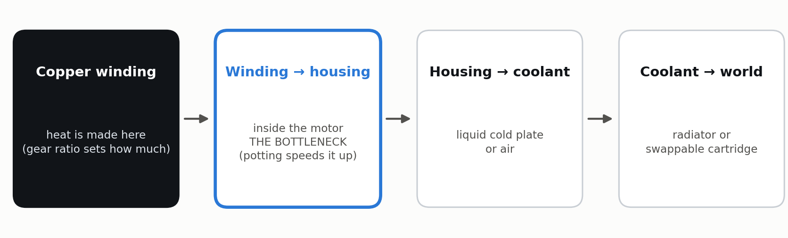
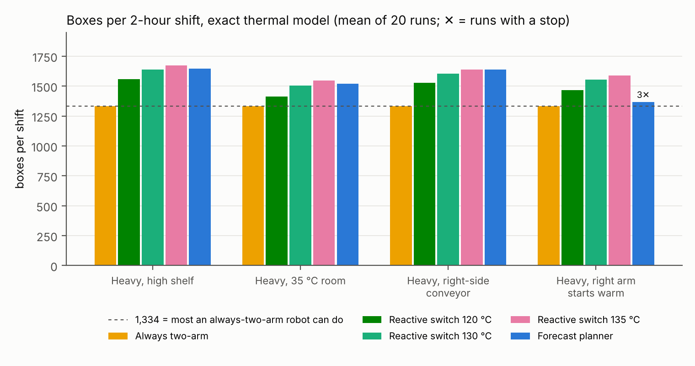
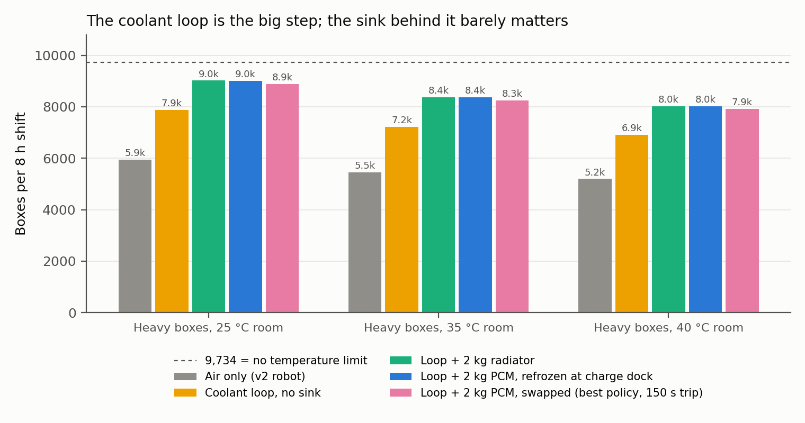
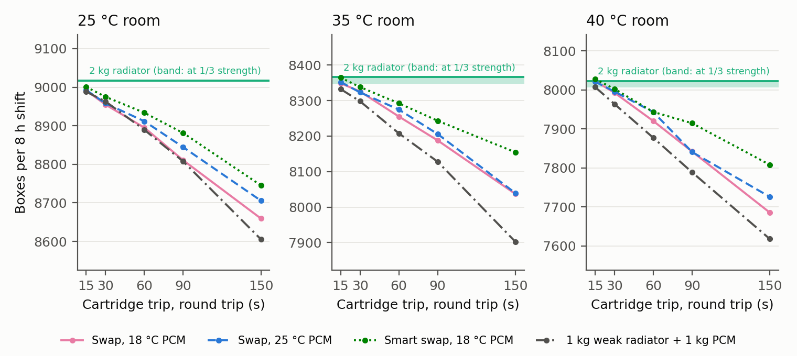
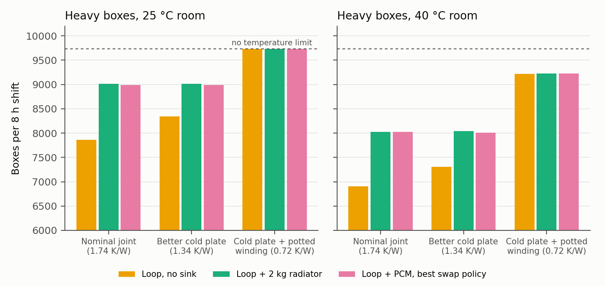
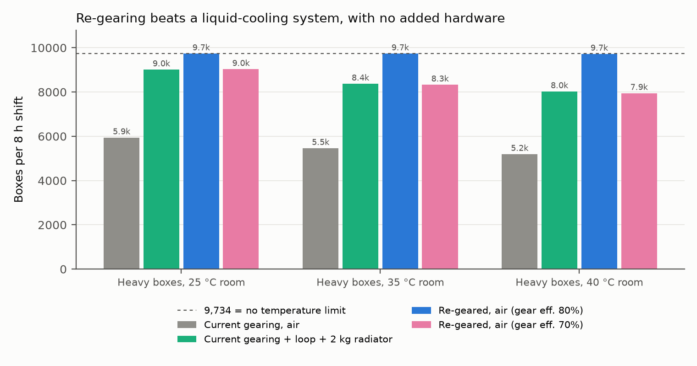
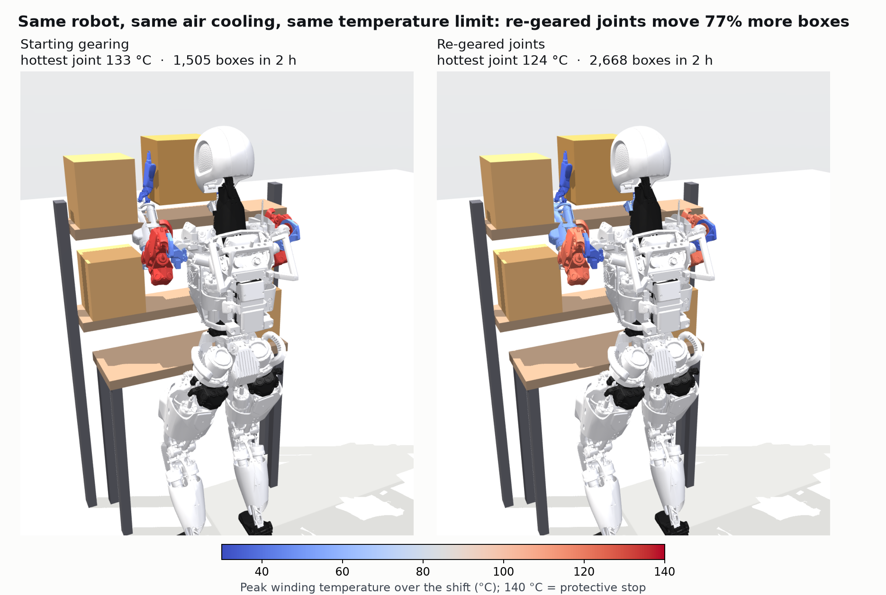
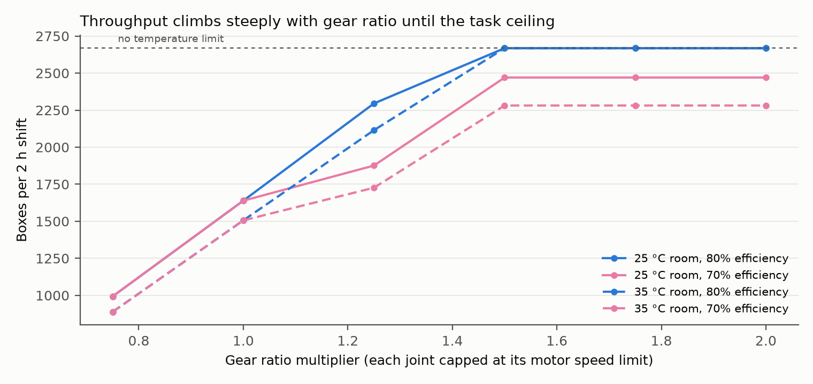
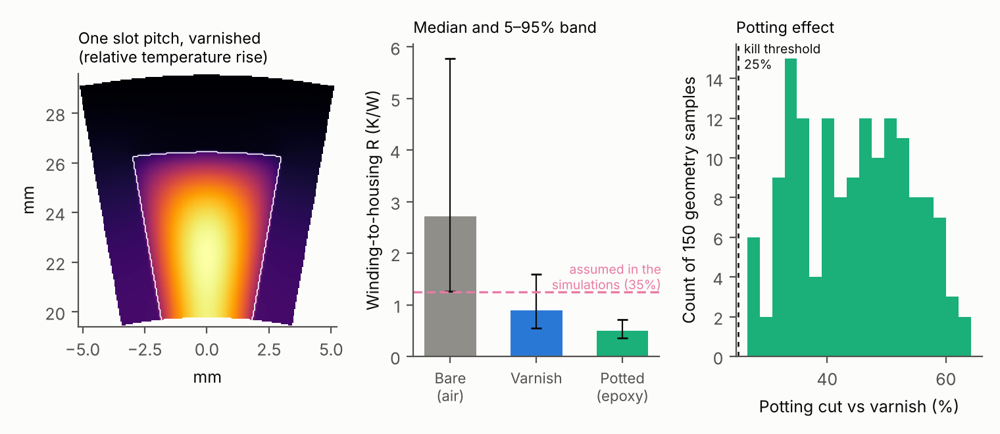
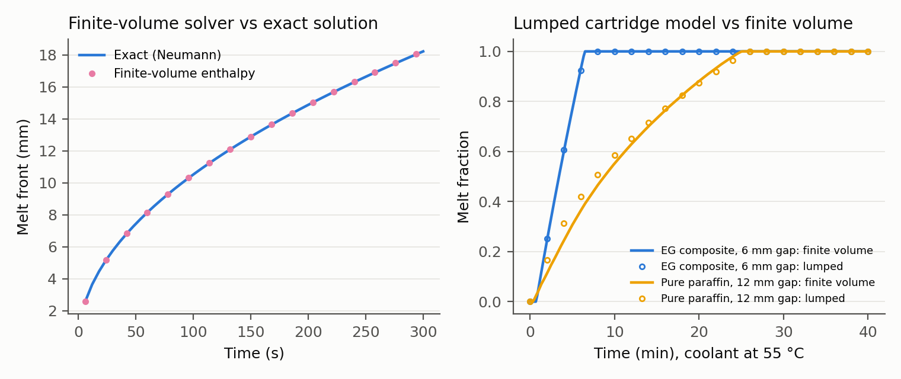

{width=82%}

*Apptronik Apollo in the simulated work cell, placing an 8 kg box on the high shelf with a two-arm grasp.*

# Abstract

A humanoid robot that lifts heavy boxes for hours is limited by its joint motors' temperature, not by their peak torque. This project asks which design change best lets such a robot work at full speed for a whole shift. Using a simulation of the Apptronik Apollo humanoid's two arms, with thermal models of all 14 joint motors matched to a commercial datasheet to within 1.1–4.9%, I ran 1,167 simulated shifts of heavy box loading at 25, 35 and 40 °C. I tested a software strategy, a novel swappable phase-change "heat battery", a liquid coolant loop, two-speed and re-geared joints, and potted motor windings. The swappable cartridge never beat a plain 2 kg radiator. A coolant loop added 32–33% throughput over air cooling. The largest gains came from inside the actuator: raising each joint's gear ratio to its motor speed limit raised throughput 64% with air cooling alone, matching or beating the liquid-cooled design, at the cost of 2.8–5 times more reflected inertia. A 2D finite-difference model of the motor's stator slot showed that potting the winding cuts its internal thermal resistance by 44% and corrected a key modeling assumption without changing any conclusion. Because the starting design is my own rather than any commercial robot's, the results are a quantified design study, not a discovery. All code and data are open.

# 1. Introduction

Humanoid robots are being deployed for warehouse work: moving totes, loading shelves and feeding conveyors for hours at a time. A joint motor can deliver its peak torque for seconds, but its continuous rating, set by how fast heat leaves its copper winding, is typically three to four times lower. A repetitive task whose average torque on one joint exceeds that rating trips the joint's protective stop partway through the shift.

Heat leaves a motor in three steps (Fig. 1), and whichever step is slowest limits the robot. Every experiment in this project turned out to be a test of which step is the bottleneck, and of what fixes it.

{width=100%}

The project ran as a sequence of experiments, each designed so that it could fail:

1. **Share the work between the arms** (software): a reactive rule switching between parallel and two-arm lifting.
2. **Swappable heat batteries**: a phase-change cartridge swapped at a dock, like a battery.
3. **A liquid coolant loop** on the eight most-loaded joints.
4. **Locating the bottleneck** along the heat path.
5. **Two-speed joints** that shift to a higher gear for heavy lifts.
6. **Re-gearing** the joints to their motor speed limits.
7. **A physics model of the motor's interior**, used to check the key assumption behind every result.

# 2. System and Models

**Robot and task.** The Apptronik Apollo model from MuJoCo Menagerie [9], both arms (14 joints) on a fixed base, loads 8 kg boxes onto a high shelf. Joint torques come from MuJoCo inverse dynamics [8] along minimum-jerk trajectories with the held box as payload. The robot can lift two boxes in parallel (one per arm) or one box with both arms.

**Joint thermal model.** Each joint is a Kollmorgen TBM(S)-6013-A frameless motor [10] driving a strain-wave gear sized so that peak motor torque matches Apollo's published joint limits. Each has a winding node $T_w$ and a housing node $T_h$, after Urata et al. [1]:

$$C_w \dot T_w = P_{cu} - \frac{T_w - T_h}{R_{wh}}, \qquad C_h \dot T_h = \frac{T_w - T_h}{R_{wh}} - \frac{T_h - T_{amb}}{R_{ha}} - \frac{T_h - T_c}{R_{cp}}$$

Copper loss uses temperature-dependent resistance and torque constant. At the datasheet's continuous current the model reproduces the rated temperature rise to within 1.1–4.9% for three motor sizes. The last term applies only when a liquid cold plate connects the housing to the coolant at $T_c$.

**Coolant loop and sinks.** One well-mixed coolant node collects heat from cold plates on the shoulder and elbow joints of both arms and rejects it to a radiator (with a bypass valve) or to a phase-change cartridge.

**Phase-change cartridge.** A lumped enthalpy model of a paraffin/expanded-graphite composite (RT44HC [12] with 15 wt% graphite [13], 187 kJ/kg, 5 W/m·K), with a melt-front conduction term that slows melting and re-freezing as they proceed.

**Shift and logistics.** An 8-hour shift with battery service every 90 minutes (9-minute dock), following Agility's published Digit 5 cadence. Cartridges are swapped at battery service or on extra trips of 15–150 s.

**Work policy.** Every option uses the same controller: lift in parallel until any winding reaches 130 °C, then lift with both arms until it cools to 120 °C, slowing above 135 °C. A winding at 140 °C triggers a protective stop and ends the shift.

**Gearing.** Re-geared cycles replace Apollo's modeled rotor inertia with the TBM motor's ($1.41\times10^{-5}$ kg·m² [10]) reflected through the new ratio, and enforce the motor's 4,000 rpm limit at every point of every trajectory.

# 3. Results

## 3.1 Sharing the work between the arms

The reactive switch completed 13–25% more boxes per 2-hour shift than always lifting with both arms (Fig. 2). A forecast-based planner that looked ahead to the end of the shift matched it but did not beat it, and was less robust to ±30% thermal-model error. Software can only spend the thermal budget the hardware provides; the rest of the project asks how to raise that budget.

{width=92%}

## 3.2 Swappable heat batteries do not beat a radiator

Adding a coolant loop with no heat sink at all raised throughput 32–33% over air cooling, by spreading heat from the hottest joints into cooler ones (Fig. 3). A 2 kg radiator added a further 15–16%. A 2 kg cartridge re-frozen at the charging dock matched the radiator to within 0.2%, and the best swapping policy fell 1.2–1.4% short.

{width=92%}

A cartridge colder than the room does make the robot faster while it works: 1,273 boxes per working hour against the radiator's 1,235 at 25 °C (+3%), and 1,151 against 1,099 at 40 °C (+5%). But it melts faster, needing 10–15 extra trips per shift that cost 25–38 minutes. Swapping only ties the radiator when a round trip takes 15 seconds (Fig. 4), and the result holds with the radiator cut to a third of its strength.

{width=92%}

## 3.3 The bottleneck is inside the motor

Making the cold plate five times better changed the radiator case by 0.3%. Halving the winding-to-housing resistance inside the motor let the coolant loop, with no heat sink at all, reach the no-temperature-limit throughput at 25 °C and 95% of it at 40 °C (Fig. 5). Once the actuator's interior conducts well, the choice of sink stops mattering.

{width=92%}

## 3.4 Gear ratio is the biggest lever

Copper loss falls with the square of the gear ratio at a given joint torque, so a higher ratio makes less heat, up to the motor's speed limit and at the cost of more reflected rotor inertia. Raising each joint's ratio to 98% of its speed headroom (capped at 2×) reached the task's ceiling with air cooling alone: 9,734 / 9,734 / 9,721 boxes per 8-hour shift at 25 / 35 / 40 °C, against 9,011 / 8,370 / 8,024 for the starting gearing with a coolant loop and radiator (Fig. 6). At a pessimistic 70% gear efficiency, re-gearing only ties the liquid-cooled design.

{width=92%}

Fig. 7 shows the same comparison on the robot itself. Both versions run up to the same temperature limit; the re-geared one turns its extra headroom into 77% more boxes in a 2-hour shift at 35 °C.

{width=100%}

Throughput rises steeply with ratio until joints reach their speed limits (Fig. 8). A two-speed joint matters only where the speed limit caps the fixed ratio, here the elbow (1.16× headroom): at 70% gear efficiency a two-speed joint with a 2× high gear reached the ceiling and peaked at 84–97 °C, where the best fixed ratio fell 8–17% short. Two-speed robot actuators already exist [11]; their thermal benefit had been argued but not simulated.

{width=88%}

The cost is reflected inertia. At its speed-limited ratio, shoulder flexion's joint-side rotor inertia rises to 0.32 kg·m², 2.8× Apollo's modeled value of 0.11 kg·m² (0.56 kg·m², 5×, with a 2× gear). That hurts collision safety and back-drivability, neither of which is modeled here.

## 3.5 The motor's interior, from physics

Every result above assumed the motor's interior holds 35% of its 3.55 K/W datasheet thermal resistance. With no bench test possible, a 2D finite-difference model of one stator slot (copper bundle, slot liner, teeth, back iron, end turns) estimated it from geometry (Fig. 9). For a varnished production winding it is about 25% (5–95%: 15–45%); potting the winding with epoxy cuts it by 44% (31–59%) across 150 random samples of every assumed dimension.

{width=100%}

Re-running the key comparisons at the physics-based value changed no ranking (Table 1). Potting added 9–10% throughput on top of air cooling or a radiator.

| Design (8 h shift, 40 °C) | Assumed 35% | Physics 25% | Potted 14% |
|---|---|---|---|
| Air only | 5,191 | 5,223 | 5,728 |
| Coolant loop, no sink | 6,904 | 7,413 | 8,584 |
| Loop + 2 kg radiator | 8,027 | 8,088 | 8,813 |
| Loop + swappable cartridge (15 s trips) | 8,024 | 8,077 | 8,783 |
| Re-geared, air only | 9,714 | 9,734 | 9,734 |

: Boxes per 8-hour shift at three winding-to-housing resistance splits (2 runs each).

\newpage

# 4. Validation

Every model was checked before its results were used (Table 2, Fig. 10). No run in any sweep hit a protective stop, and run-to-run spread was under 15 boxes per configuration.

| Model | Checked against | Agreement |
|---|---|---|
| Joint thermal model | Datasheet rated temperature rise, 3 motors | 1.1–4.9% |
| Phase-change solver | Exact Neumann melting solution | 0.16% |
| Lumped cartridge | 1D finite-volume solver | 3% in time to 90% melt |
| Coolant loop + joints | Energy balance | 0.2% |
| Stator-slot solver | Exact heated-annulus solution | 0.07% |
| Winding-bundle conductivity | Fine-grid wire-array model | 1–8% |

: Model validation.

{width=92%}

# 5. Discussion and Limitations

**What the project shows.** For humanoid arms doing heavy repetitive work, thermal performance is won inside the actuator: the gear ratio first, then how well the winding conducts heat. External cooling helps, but less than expected, and a swappable cartridge, while novel, solves a problem this robot does not have.

**What it does not show.** The starting design is my own: Kollmorgen motors with gear ratios sized to peak torque. It is not Apollo's real actuators, and not Tesla Optimus's or Figure's. Commercial teams already size gear ratios with heat in mind, so every gain here is relative to a design never optimized for heat.

**Limitations.**

- Simulation only: two arms on a fixed base and one slow repetitive task (peak joint speeds 2–4 rad/s).
- Reflected inertia, collision safety and back-drivability are not modeled.
- Motor internals (slot count, copper fill, liner) are assumed; slot count dominates the uncertainty.
- Gear efficiency is held at 80% or 70%; two-speed shifting is ideal, an upper bound.
- The coolant loop is one well-mixed node; pump power and flow distribution are not modeled.

# 6. Conclusion

I set out to test whether a humanoid should swap heat the way it swaps batteries, and found that it should not: across 795 shifts a swappable phase-change cartridge never beat a 2 kg radiator. Following that negative result to its cause located the thermal bottleneck inside the motor. A coolant loop is worth 32–33% over air cooling; re-gearing the joints is worth more, matching or beating liquid cooling with no added hardware; and potting the winding adds 9–10%. Code, parameters and all data: <https://github.com/sharanankathi/thermal-aware-humanoid-planner>.

# References

1. J. Urata et al., "Thermal control of electrical motors for high-power humanoid robots," *Proc. IEEE/RSJ IROS*, 2008, pp. 2047–2052.
2. I. Kumagai et al., "Whole body joint load reduction control for high-load tasks of humanoid robot through adapting joint torque limitation based on online joint temperature estimation," *Proc. IEEE-RAS Humanoids*, 2014.
3. S. J. Jorgensen et al., "Thermal recovery of multi-limbed robots with electric actuators," *IEEE Robotics and Automation Letters*, 2019.
4. K. Kawaharazuka et al., "Estimation and control of motor core temperature with online learning of thermal model parameters," arXiv:2407.08055, 2024.
5. T. Kozuki et al., "Skeletal structure with artificial perspiration for cooling by latent heat for musculoskeletal humanoid Kengoro," *Proc. IEEE/RSJ IROS*, 2016.
6. E. Sevinchan, I. Dincer, and H. Lang, "A review on thermal management methods for robots," *Applied Thermal Engineering*, vol. 140, 2018.
7. Intel Corporation, "Unmanned aerial vehicle and method for operating an unmanned aerial vehicle," US Patent 10,850,841.
8. E. Todorov, T. Erez, and Y. Tassa, "MuJoCo: A physics engine for model-based control," *Proc. IEEE/RSJ IROS*, 2012.
9. K. Zakka, Y. Tassa, and MuJoCo Menagerie Contributors, "MuJoCo Menagerie," 2022, <https://github.com/google-deepmind/mujoco_menagerie>.
10. Kollmorgen, "TBM frameless motor selection guide," KM_SG_00218_RevE_EN, 2017.
11. A. Girard and H. H. Asada, "A two-speed actuator for robotics with fast seamless gear shifting," *Proc. IEEE/RSJ IROS*, 2015; arXiv:2405.16652.
12. Rubitherm, "RT44HC technical data sheet."
13. Paraffin/expanded-graphite composite PCM conductivity data, *Journal of Energy Storage*, 2023.

# Appendix: Reproducing the Results

| Study | Command | Output |
|---|---|---|
| Heat cartridge vs radiator | `python experiments/run_cartridge.py melt` (also `crossover`, `joint`) | `results/cartridge/` |
| Gear ratio and two-speed | `python experiments/run_gearing.py shift8h` (also `shift2h`, `ratio`) | `results/gearing/` |
| Motor slot physics | `python experiments/make_figures_slot.py` | `results/slot/slot.csv` |
| Split check | `python experiments/run_split.py` | `results/split/split.csv` |
| Robot thermal render | `python experiments/make_thermal_render.py` | `figures/` |
| Model tests | `pytest -q tests/` | pass / fail |
